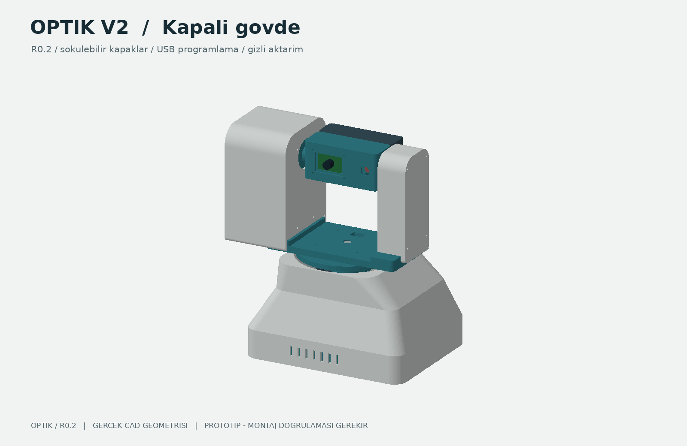
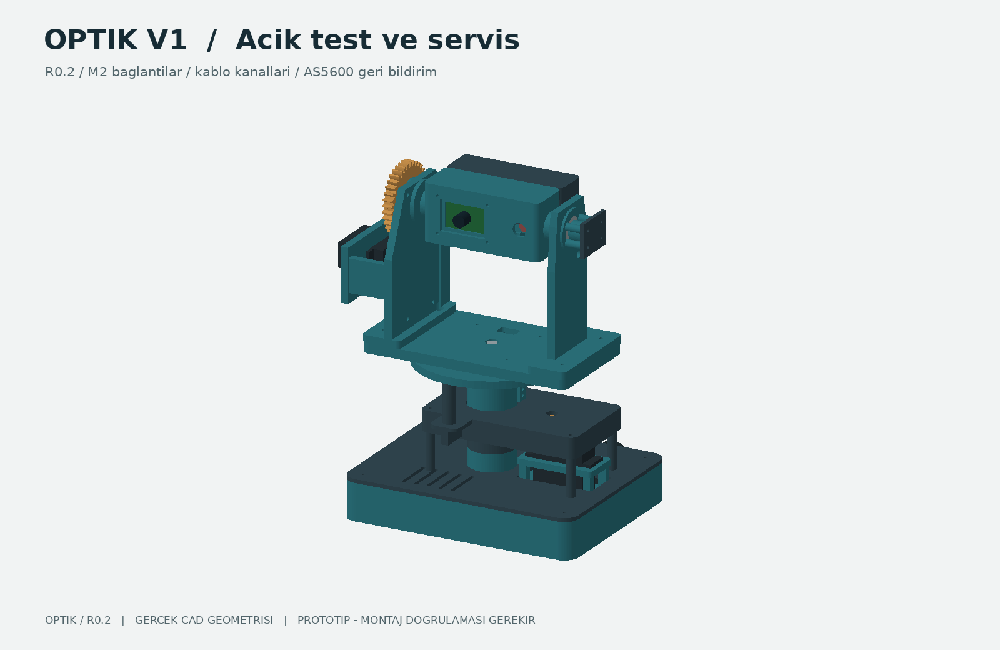
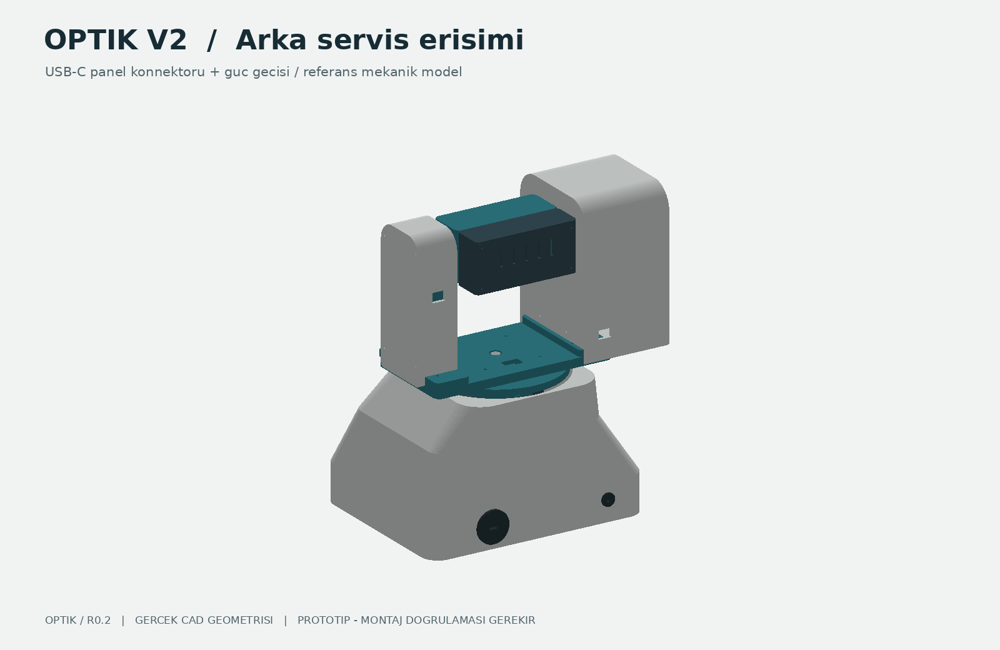
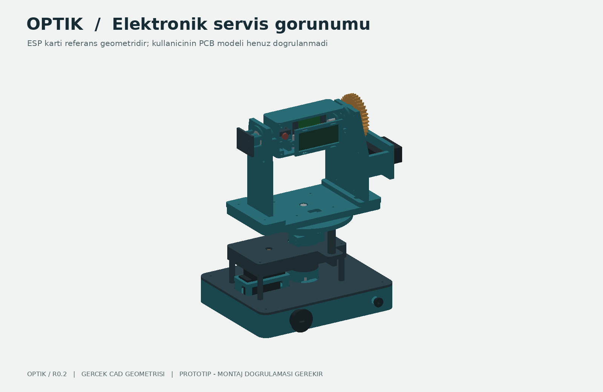

# OPTIK — kamera ve ışık platformu

**R0.2 mühendislik prototipi.** Bambu Lab X1 Carbon için, iki eksenli ve rulmanlı optik laboratuvar platformu. V1 açık test/servis, V2 sökülebilir kapaklı sürümdür. Yalnız kamera ve üreticisinin Sınıf 1 olarak belirttiği küçük optik modül taşır.

## Dosyalar

- [{{PAGE_COUNT}} sayfa A3 teknik PDF](drawings/OPTIK-teknik-cizimler.pdf): üç görünüş, dış ölçüler, kritik delik/pattern ölçüleri ve montaj notları.
- [V1 montaj STEP ZIP](cad/OPTIK-V1-montaj.zip) · [V2 montaj STEP ZIP](cad/OPTIK-V2-montaj.zip).
- `cad/`: {{PART_COUNT}} düzenlenebilir STEP parçası. `stl/`: baskı yönüne çevrilmiş, Z=0 STL dosyaları.
- [Donanım listesi](BOM.csv) · [Bağlantı bazında M2 vida planı](drawings/vida-plani.csv) · [Temel delik koordinatları](drawings/delik-koordinatlari.csv) · [Eklem referansları](joint-frames.json).
- [Parça kontrolleri](checks/part-checks.json) · [Montaj örneklemesi](checks/assembly-checks.json).
- [MuJoCo V1 videosu](simulation/optik-v1.mp4) · [MuJoCo V2 videosu](simulation/optik-v2.mp4) · [Simülasyon kapsamı](simulation/README.md).

## Mekanik tasarım

Pan ve tilt hedef aralığı ±90°; iki eksende 608 rulman ve mekanik durdurucu vardır. Tilt ekseni Z227 mm. Dişli çifti m1.5, 30/36 diş, 20° basınç açısı, 49.5 mm eksen aralığıdır. Oran 5:6'dır; boşluk ve doğruluk fiziksel prototipte ölçülür.

Montaj bağlantıları M2'dir. Rulman milleri D8, sol tilt mili M8×35 DIN931, sağ tilt omuz mili D8×16/M6 olarak kalır. Uzun M2 vidaların baş/diş zinciri ve rijitliği fiziksel montajda kontrol edilmelidir. Insert siparişi, seçilen üreticinin delik ölçüsü ve P24 kuponu görülerek kesinleştirilir.

V2 alt kabuk yaklaşık 205×165 mm; tüm parça STL'leri nominal 256³ mm X1 Carbon hacmine göre kontrol edilir. Başlangıç: PETG, üreticinin profili, 0.4 mm nozül, 0.20 mm katman, 5 duvar, 6 üst/alt ve %30 dolgu. Dikmeler/yan çıkıntılar yerel destek ister. Önce P24 geçme kuponu, sonra tek eklem prototipi basılmalıdır. Dilimleyici önizlemesi ve gerçek baskı yapılmadı.

## Elektronik ve kablo yolları

ESP başlığın P06 sırtında P25 kasetiyle taşınır; kamera DVP bağlantısı kısa tutulur. Referans kart, **ESP32-S3 DevKitC-1 62.74×25.40 mm** dış ölçüsüne göre görselleştirilmiştir. N16R8 bellek çeşididir; kullanıcının PCB modeli henüz doğrulanmadı. Gösterilen servo/PCB/USB geometrileri boyutsal referans zarflarıdır, üretici orijinal CAD'i değildir. Kullanıcının kartı ve servo varyantı ölçülmeden birebir uyum sözü verilemez.

P16 altındaki kanallar 12 mm genişlik, 4.5 mm derinlik; ayak geçişleri D8.5 mm'dir. Pan flanşı altında R22–44 mm çevresinde servis halkası için boşluk bırakıldı. Esnek, ince demet ve başlangıçta en az 15 mm bükülme yarıçapı hedeflenir. Gerçek kablo geometrisi/hareket testi henüz yapılmadı. Arka USB-C panel #4218 ile programlama erişimi, ayrı D10 güç geçişi vardır. 30 cm panel kablosuna ek uzatma ve kart ucunda ince köşe fişi gerekebilir; fiş çakışmaları gerçek kartla doğrulanır.

Kullanıcının 360° diye satın aldığı üç kablolu MG996R, sürekli dönüşlü kabul edildi. Üç kablo açı telemetrisi sağlamaz; iki AS5600 geri bildirimi korunur. Sensörlerin I2C adresi aynı olduğundan iki ayrı I2C hattı veya çoklayıcı gerekir. Servolar ayrı regüle kaynakla beslenir, ESP ile GND ortaktır. L298N RC servo sürücüsü olarak kullanılmaz. Kesin GPIO ataması ve firmware bu CAD paketine dahil değildir.

## Kontrollerin sınırı

Üretim betikleri her STEP için tek geçerli katı; her STL için kapalı ağ, pozitif hacim, Z=0 ve baskı hacmi kontrolü uygular. Montaj kontrolü nötr konum, seçili tilt açıları, pan durdurucuları ve dişli temasını örnekler. Sonuçlar JSON raporlarındadır. Tüm vida/fiş başları, sürekli çarpışma, kablo kuvvetleri, dayanım, termal davranış, optik hizalama ve gerçek donanım uyumu bu raporlarla kanıtlanmaz.

MuJoCo XML modelleri CAD görsellerini SI birimleriyle kullanır; kütle/ataletler ve konum aktüatörleri yaklaşık gösterim parametreleridir. Gerçek MG996R sürekli dönüş kontrolü ve elektriksel davranışı modellenmedi. Video bir hareket gösterimidir; kalibre edilmiş dijital ikiz veya donanım başarım testi değildir. [Simülasyon raporu](simulation/simulation-report.json) ve eklem CSV'leri tekrar üretilebilir.

Delik CSV'si temel dairesel delik/pattern merkezlerini **parçanın STEP koordinatlarında** verir; döndürülmüş STL koordinatlarında değildir. P03–P08 ve P25 montajda Z227 mm taşınır. Slotlar, cepler ve yüzeyler için STEP esastır. PDF prototip teknik pakettir; alüminyum imalatı için eksiksiz GD&T/tolerans onayı değildir.

## Alüminyum revizyonu

FDM kabuklarını doğrudan CNC'ye göndermek yerine köprü/dikmeler düz plaka ve ara parçalarla yeniden tasarlanmalıdır. Metal yatak geçmeleri, M2 diş/vida taşıma kapasitesi, kütle/atalet, servo yeterliliği ve ESP anten açıklığı yeniden değerlendirilir. Mevcut STEP'ler revizyon başlangıcıdır; metal üretim onayı verilmedi.

## Yeniden üretim

`pip install -r requirements-ci.txt`, ardından sırasıyla `python model.py`, `python validate.py`, `python documents.py`, `python publish.py`, `python prepare_simulation.py`, `python simulate.py`. Linux video için `libosmesa6` gerekir. GitHub Actions'taki **Build CAD and MuJoCo previews** iş akışı aynı adımları çalıştırır. PDF ve video ancak bu akış başarıyla tamamlandıktan sonra sürüme alınır.

## Üretici kaynakları

- [Tower Pro MG996R](https://towerpro.com.tw/product/mg996R/): gövde ölçüleri ve sürüm bilgileri. Mevcut 360° varyant ayrıca doğrulanmalıdır.
- [Waveshare OV5640 Board A](https://www.waveshare.com/product/modules/cameras-audio-video/cameras/ov5640-camera-board-a.htm): 35.7×23.9 mm PCB, 5 MP, DVP. Azami çözünürlük hızlı kare hızı garantisi değildir.
- [Espressif kamera sürücüsü](https://github.com/espressif/esp32-camera) · [DevKitC-1 resmi ölçü çizimi](https://dl.espressif.com/dl/PCB_ESP32-S3-DevKitC-1_V1_20210312CB.pdf).
- [Picotronic DI650-0.4-3(8x21)](https://www.picotronic.de/picopage/en/product/detail/id/1934/category/3): Ø8×21 mm, 650 nm, 0.4 mW, üreticinin Class 1 sınıflandırması. Tam cihaz sınıfı ayrıca değerlendirilir.
- [Adafruit AS5600 PCB](https://github.com/adafruit/Adafruit-AS5600-Magnetic-Angle-Sensor-PCB): 25.4×17.78 mm kart, 20.32×12.70 mm delik aralığı yayımlanan Eagle dosyasından çıkarılmıştır; PCB dosyası yeniden dağıtılmıyor.
- [AS5600 kılavuzu](https://learn.adafruit.com/adafruit-as5600-magnetic-angle-sensor) · [USB-C panel #4218](https://www.adafruit.com/product/4218).
- [Bambu Lab X1 Carbon teknik özellikleri](https://public-cdn.bambulab.com/store/bambulab-X1-carbon-tech-specs.pdf?v=20241214042009) · [MuJoCo Python API](https://mujoco.readthedocs.io/en/3.2.7/python.html).
